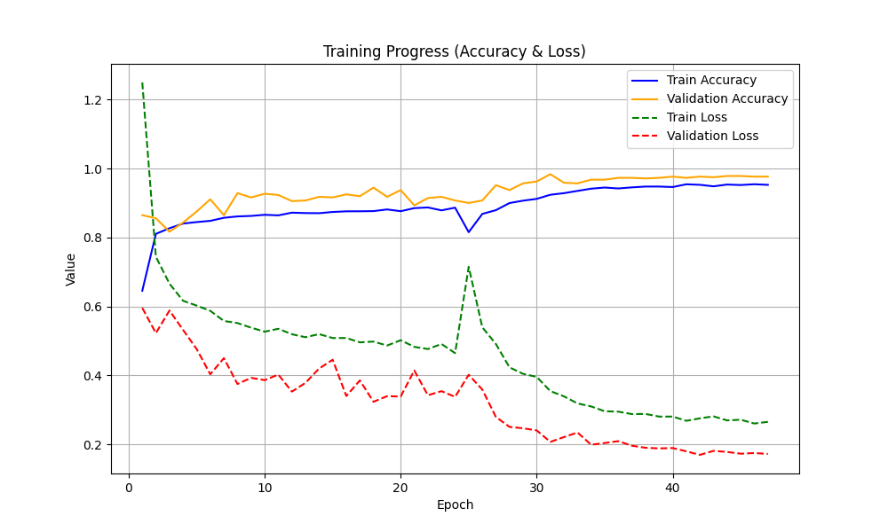
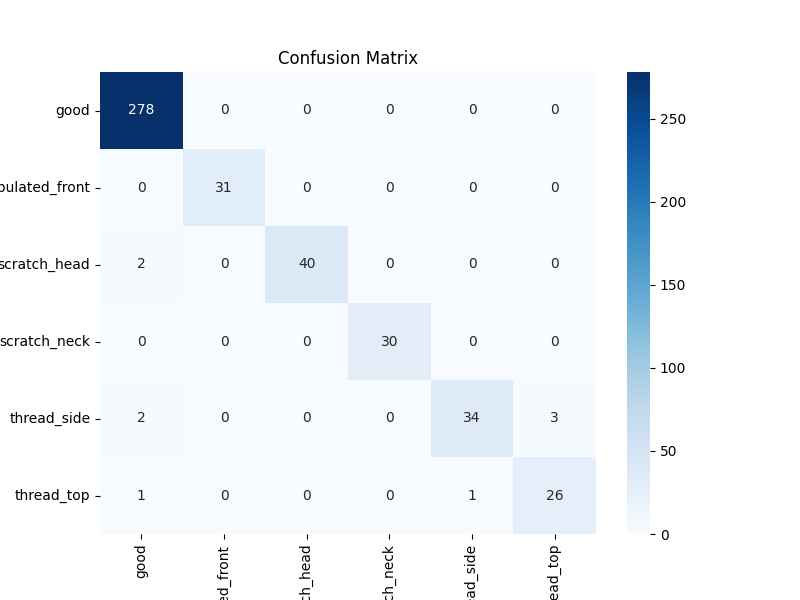
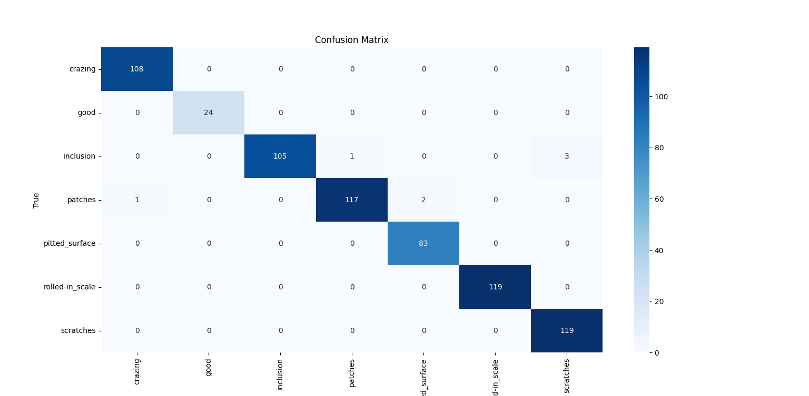

# Defect Detection with ResNet50V2 & MobileNetV2

Automated visual defect detection for manufactured parts (**screws** and **sheet metal**) using transfer learning with deep CNNs — group project (Group 6) for **DPL302m – Deep Learning** at FPT University.

The goal is to identify and classify defects on production-line images to improve quality-control efficiency and reduce manual inspection cost.

## Dataset

Built by merging several public sources into one consistent folder structure — **33,394 images (~2.9 GB)** in total.

| Category | Images | Sources | Classes |
|----------|-------:|---------|---------|
| Screw | 8,195 | MVTec AD, Kaggle, Roboflow Universe | `good`, `manipulated_front`, `scratch_head`, `scratch_neck`, `thread_side`, `thread_top` |
| Sheet metal | 25,199 | MVTec AD, Roboflow Universe (NEU Surface Defect Database) | `good`, `crazing`, `inclusion`, `patches`, `pitted_surface`, `rolled-in_scale`, `scratches` |

MVTec AD and NEU provide clean benchmark images; Kaggle and Roboflow add scale and real-factory variability (noisy backgrounds, uneven lighting). Images are resized, normalized and split 70 / 15 / 15 into train / validation / test. Details: [`docs/Data_Collection_Report.docx`](docs/Data_Collection_Report.docx).

> The dataset and trained weights (`.h5`) are not included in this repository because of their size.

## Approach

1. **Data preparation** — merge the source datasets, map file names / annotation CSVs to class folders, filter unusable images and check the splits.
2. **Models** — transfer learning from ImageNet with a two-stage schedule: train a new classification head on a frozen backbone, then unfreeze the upper layers and fine-tune with a low learning rate (AdamW, early stopping, best-checkpoint saving). Class weights handle class imbalance.
   - **ResNet50V2** (224×224) — best screw model
   - **MobileNetV2** (192×192) — lightweight model for deployment; also a frozen-backbone 128×128 baseline
   - Experiments with **EfficientNet-B4** and a **Vision Transformer**
3. **Explainability** — Grad-CAM heatmaps with bounding boxes to show which regions drive each prediction.

## Results (test set)

| Dataset | Model | Correct / total | Accuracy |
|---------|-------|----------------:|---------:|
| Screw | ResNet50V2 | 439 / 448 | **98.0 %** |
| Screw | MobileNetV2 | 436 / 448 | 97.3 % |
| Sheet metal | Fine-tuned CNN | 675 / 682 | **99.0 %** |

| ResNet50V2 training curves (screw) | ResNet50V2 confusion matrix (screw) |
|:---:|:---:|
|  |  |



## Project structure

```
├── src/
│   ├── data_preparation/   # merge sources, organize class folders, filter images, check splits
│   ├── models/             # ResNet50V2, MobileNetV2, EfficientNet-B4, ViT training scripts
│   └── explainability/     # Grad-CAM with bounding boxes
├── results/                # confusion matrices and training curves
├── docs/                   # project proposal, data collection report, figures
└── requirements.txt
```

## Usage

```bash
pip install -r requirements.txt
python src/models/resnet50v2_finetune.py
python src/explainability/gradcam_boxes.py
```

The scripts use absolute dataset paths set at the top of each file (`base_dir`, `model_path`); change them to point to your local copy of the dataset.

## Team

Trần Ngọc Nhơn · Nguyễn Quốc Anh · Phan Quốc Trung · Vũ Lâm Thái Vinh

## Tech stack

Python · TensorFlow / Keras · scikit-learn · OpenCV · NumPy · pandas · Matplotlib / Seaborn
